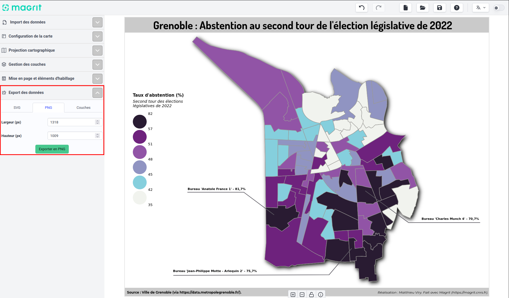
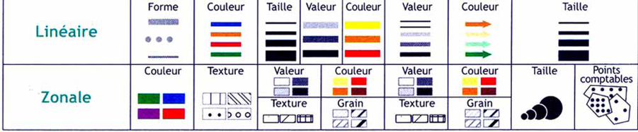
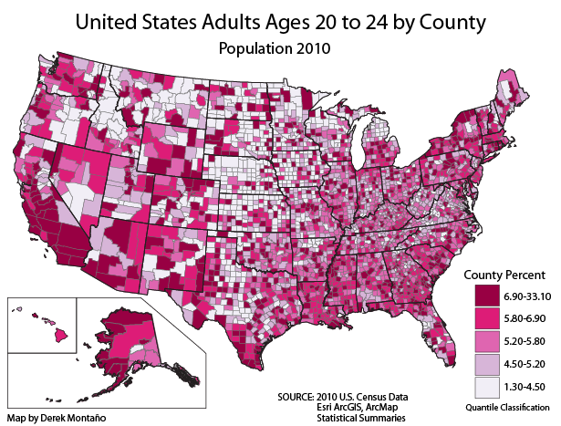

# Cartes thématiques avec MAGRIT et Kepler.gl

## Présentation de MAGRIT

[MAGRIT](https://magrit.cnrs.fr/) est une interface de cartographie, sous format web, opensource, produite par l'UAR (Unité d'Appui et de Recherche) [RIATE](https://riate.cnrs.fr/).

L'objectif de l'interface est de permettre de produire facilement différents types de cartes thématiques, pouvant faire appel à différentes approches et styles, sans avoir de compétences en SIG à priori.

## Rappel sur les différents types de données

La sémiologie graphique définit quatre types de données:
- les données quantitatives, pouvant être chiffrées, et parmi elles:
    - les données quantitatives absolues, ou de stock, décrivant des valeurs quantitatives brutes
    - les données quantitatives relatives, décrivant des valeurs normalisées (par exemple, des valeurs de densité, de ratio)
- les données qualitatives, ne pouvant pas être chiffrées, et parmi elles:
    - les données qualitatives ordinales, décrivant différentes catégories ordonnées
    - les données qualitatives nominales, décrivant différentes catégories non-ordonnées.

Ces différents types de données peuvent être représentés par différentes variables visuelles

La taxonomie de Munzner classe les variables visuelles selon qu'elles représentent une magnitude (données quantitatives ou qualitatives ordonnées) ou une identité (données qualitatives nominales).

## Représenter des donnnées quantitatives absolues dans une carte

### Cartes en symboles proportionnels

#### Au moyen du jeu de données XX, produisez une carte en symboles proportionnels, représentant la population mondiale selon les différents pays

*Par quel canal visuel représente-t'on l'information?*

*Pourquoi ne passe-t'on pas par de la couleur?*

*Pour chaque individu du jeu de données, le symbole portant l'information sur la population est différent du symbole représentant la composante spatiale de l'individu. Pourquoi utilise-t'on un deuxième symbole?*

### Au dela des cartes en symboles proportionnels

#### Au moyen du jeu de données XX, produisez deux cartogrammes représentant la population mondiale, un selon l'algorithme d'Olson, un autre selon l'algorithme de Gastner, Seguy et More.

*Par quel canal visuel représente-t'on l'information? Au moyen de quel symbole*

*Décrivez ce qui différencie les deux approches, et quels sont leur avantages et inconvénients*

## Carte choroplèthes

### Le principe

Une carte choroplèthe est une carte où la couleur (ou un autre figuré surfaçique) est utiliser pour représenter des données quantitatives, relatives à une division, usuellement irrégulière, de l'espace. 

### Représenter des densités par de la couleur

#### Au moyen du jeu de données XX, produisez une carte choroplèthe représentant la population brute par pays.

*Si vous n'y arrivez pas, pourquoi selon vous?*

*Pour quelle variable, relative à la population, pouvez-vous produire une carte choroplèthe?*

*Pensez vous que l'utilisation de cercles proportionnels seraient une bonne approche pour représenter cette variable? Pourquoi?*

### Influence de la méthode de classification

#### Au moyen du jeu de données XX, produisez une carte choroplèthe représentant la densité de population par pays, au moyen d'une classification en quantile, en intervalle égaux, et en utilisant l'approche des seuils naturels de Jenks.

*Au moyen du menu de symbologie avancée (icone rouage dans le menu de choix du mode de classification), décrivez la différence entre ces différentes approches, et choisissez l'approche vous semblant la plus appropriée*

*Choisissez l'approche vous semblant la plus appropriée sur les données*

### Influence de la palette de couleur

#### Au moyen du jeu de données XX, produisez une carte choroplèthe représentant le taux de natalité par pays.

*La palette de couleur précédemment utilisée vous parait-elle appropriée? Sinon changez de palette de couleur*

#### Combinez dans une carte la représentation de la population et la représentation du taux de natalité.

## Représentez des discontinuités spatiales

#### Au moyen de l'option correspondante, représentez les différentiels de PIB par habitants entre pays. Ajoutez cette information à la carte précédente.

*Quel canal visuel est utilisé ici?*

## Influence de la projection utilisée

#### Changez la projection de la carte pour une projection de Mercator.

*Quelle différence voyez-vous avec la projection précédente. Revenez à la projection précédente.*

#### Au moyen de l'outil de mise en page, finalisez votre carte en organisant la légende, en ajoutant titre, échelle, source et orientation.

## Représenter des données non-ordonnées

faire choroplèthe catégorielle sur données geol

carte choroplèthe catégorisée
	- nominal
		MAGRIT carte géol: influence de la palette catégoriel
		MAGRIT sous groupes: jouer sur la teinte et les nuances de gris pour faire différenciation et association

## Présentation de Kepler.gl

## Création de cartes choroplèthes avec Kepler.gl

carte densité IDF

## Création de cercles proportionnels avec Kepler.gl	

carte cercle prop IDF (fournir les points dna sla carte, mais montrer qu'on a un probleme : rayon)

## Création de cartes en 2D+1 

montrer le pour et le contre, et l'intéret du carroyage

garder le réseau pour QGIS pour faire du glyphes
faire le cyclique dans QGIS
montrer l'influence de la palette pour le nombre de couleur dans QGIS
=> pe pas
