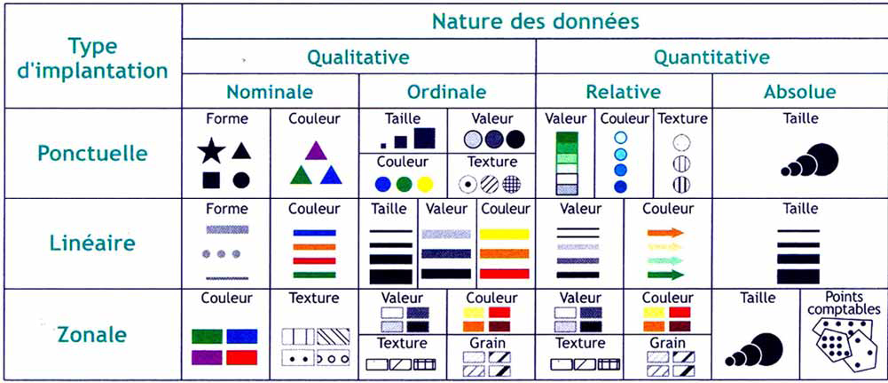
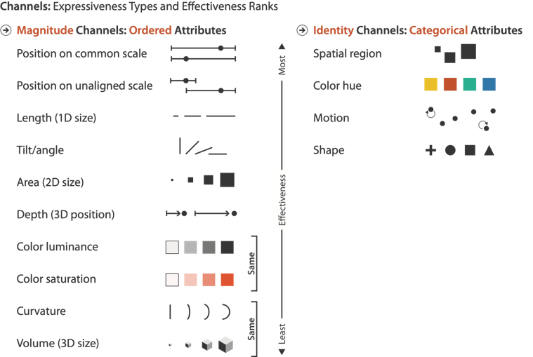
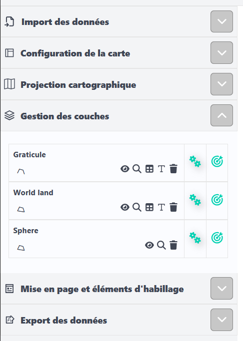
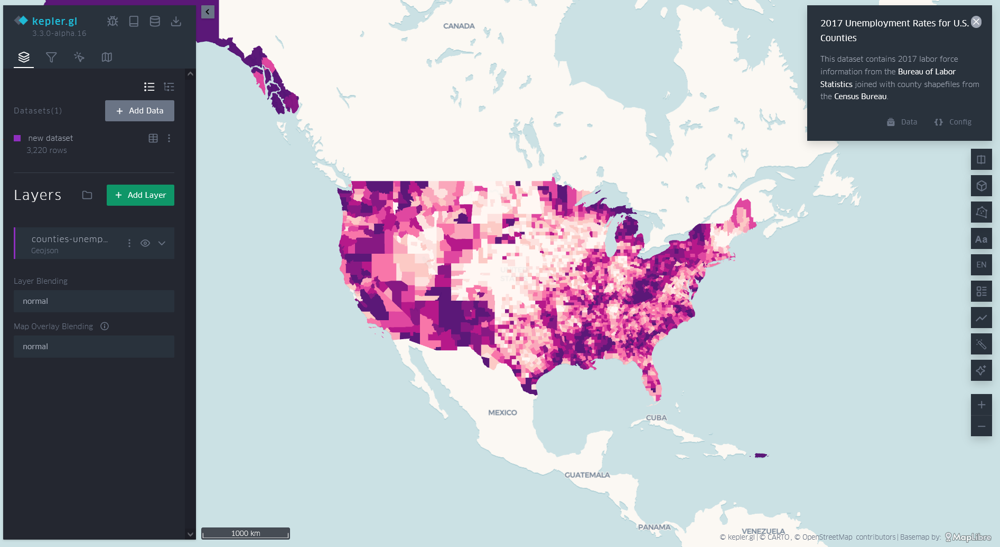
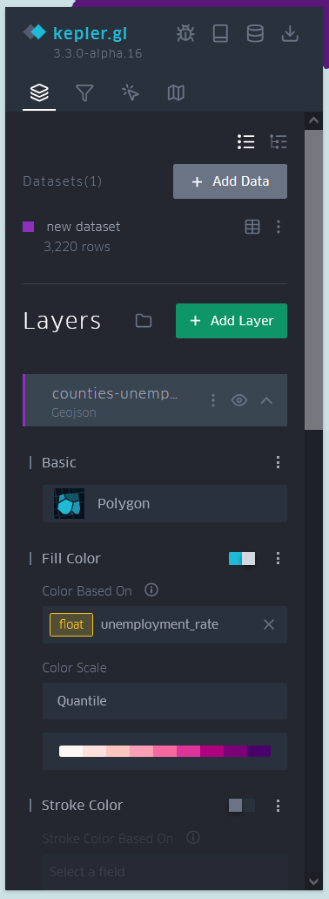
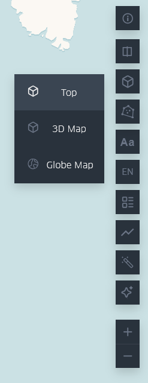

# Cartes thématiques avec MAGRIT et Kepler.gl

Le but de cet exercice est d'illustrer plusieurs concepts vus en cours sur la visualisation de données géospatiales, au moyen des interfaces MAGRIT et Kepler.gl, permettant de produire des représentations cartographiques sans code, ni compétences SIG.

## Présentation de MAGRIT

[MAGRIT](https://magrit.cnrs.fr/) est une interface de cartographie, sous format web, opensource, produite par l'UAR (Unité d'Appui et de Recherche) [RIATE](https://riate.cnrs.fr/).

L'objectif de l'interface est de permettre de produire facilement différents types de cartes thématiques, pouvant faire appel à différentes approches et styles, sans avoir de compétences en SIG à priori.

## Rappel sur les différents types de données et leurs relations avec l'utilisation de symboles graphiques.

La sémiologie graphique définit quatre types de données:
- les données quantitatives, pouvant être chiffrées, et parmi elles:
    - les données quantitatives absolues, ou de stock, décrivant des valeurs quantitatives brutes
    - les données quantitatives relatives, décrivant des valeurs normalisées (par exemple, des valeurs de densité, de ratio)
- les données qualitatives, ne pouvant pas être chiffrées, et parmi elles:
    - les données qualitatives ordinales, décrivant différentes catégories ordonnées
    - les données qualitatives nominales, décrivant différentes catégories non-ordonnées.

Selon les règles de la sémiologie graphique de Bertin, la représentation graphique de ces différents types de données doit mettre en lumière différentes relations entre individus du jeu de données:
- relation d'association: deux symboles sur la carte représentent tous deux des routes.  On peut alors utiliser une même teinte de couleur. 
- relation de différenciation: deux symboles sur la carte représentent pour l'un une route, pour l'autre un cours d'eau. On peut alors utiliser deux teintes de couleur différentes. 
- relation d'ordre: deux symboles sur la carte représentent pour l'un une route principale, pour l'autre une route secondaire.  On peut alors utiliser un dégradé de niveaux de gris.
- des quantités de différentes proportions: deux symboles sur la carte représentent pour l'un une route où passent 500 voitures par jour, pour l'autre une route où passent 1000 voiture par jour, soit une deux fois plus.  On peut alors utiliser la taille des symboles. 

La taxonomie de Munzner reconnait deux types d'attributs pouvant être représenté par des canaux visuels/des variables visuelles. Les variables visuelles sont donc classées selon qu'elles représentent une magnitude (données quantitatives ou qualitatives ordonnées, représentation d'un ordre où d'une proportion entre valeurs quantitatives) ou une identité (données qualitatives nominales, représentation d'une relation d'association ou de différenciation).

## Représenter des donnnées quantitatives absolues dans une carte

### Cartes en symboles proportionnels

#### Au moyen du jeu de données XX, produisez une carte en symboles proportionnels, représentant la population mondiale selon les différents pays.

Après avoir importer vos données au moyen de l'onglet dédié, Vous pouvez choisir parmi différentes approches pour représenter vos données en cliquant sur le symbole décrivant une cible, dans l'onglet gestion de couches.

*Par quel canal visuel représente-t'on l'information?*

*Pourquoi ne passe-t'on pas par de la couleur?*

*Pour chaque individu du jeu de données, le symbole portant l'information sur la population est différent du symbole représentant la composante spatiale de l'individu. Pourquoi utilise-t'on un deuxième symbole?*

### Au dela des cartes en symboles proportionnels

#### Au moyen du jeu de données XX, produisez deux cartogrammes représentant la population mondiale: un selon l'algorithme d'Olson, un autre selon l'algorithme de Gastner, Seguy et More.

*Par quel canal visuel représente-t'on l'information? Au moyen de quel symbole?*

*Décrivez ce qui différencie les deux approches, et quels sont leurs avantages et inconvénients*

## Carte choroplèthes

### Le principe

Une carte choroplèthe est une carte où la couleur (ou un autre figuré surfaçique) est utilisée pour représenter des données quantitatives relatives à une division, usuellement irrégulière, de l'espace. 

### Représenter des densités par de la couleur

#### Au moyen du jeu de données XX (jeu de données population, densité de population, PIB, et taux de natalités par pays à importer), produisez une carte choroplèthe représentant la population brute par pays.

*Si vous n'y arrivez pas, pourquoi selon vous? Modifiez le typage des champs de la couche correspondante, en appuyant sur le symbole "T" dans l'onglet de gestion de couche, puis retentez de créer cette carte choroplèthe (ce n'est pas toutefois pas une bonne façon de procéder)*

*Pour quelle variable, relative à la population, pouvez-vous produire une carte choroplèthe?*

*Pensez vous que l'utilisation de cercles proportionnels seraient une bonne approche pour représenter cette nouvelle variable? Pourquoi? Modifiez le typage des champs de la couche correspondante de manière à créer une carte en cercles proportionnels et tentez l'experience.*

### Influence de la méthode de classification

#### Au moyen du jeu de données XX (jeu de données population, PIB,  et densité par pays à importer), produisez une carte choroplèthe représentant la densité de population par pays, au moyen d'une classification en quantile, en intervalle égaux, et en utilisant l'approche des seuils naturels de Jenks.

Ouvrez le menu de symbologie avancée (icone rouage dans le menu de choix du mode de discrétisation, voire figure ci-dessous).
Choisissez le mode de discrétisation que vous souhaitez.

*Au moyen de l'histogramme du menu de symbologie avancée, décrivez la différence entre ces différentes approches.* 

#### Au moyen de l'histogramme et de la boîte à moustache dans le menu de symbologie avancée, choisissez l'approche qui vous semble la plus appropriée. Utilisez la palette de couleur Viridis.*

### Influence de la palette de couleur

#### Au moyen du jeu de données (jeu de données population, densité, PIB,  de population, et taux de natalités par pays à importer), produisez une carte choroplèthe représentant le taux de natalité par pays.

*La palette de couleur précédemment utilisée vous parait-elle appropriée? Sinon changez de palette de couleur*

#### Combinez dans une carte la représentation de la population et la représentation du taux de natalité.

*Quelles variables visuelles allez-vous utiliser, et à travers quels symboles pouvez-vous les utiliser?*

## Représentez des discontinuités spatiales

#### En explorant les différentes approches proposées par MAGRIT, proposez une représentation du PIB par habitant qui mette en lumière les ruptures dans la distribution spatiale de cette variable. Ajoutez cette information à la carte précédente.

*Quel canal visuel est utilisé ici?*

## Influence de la projection utilisée

#### Au moyen de l'onglet correspondant dans le menu principal de MAGRIT, à gauche, modifiez la projection de la carte pour une projection de Mercator.

*Quelle différence voyez-vous avec la projection précédente. Revenez à la projection précédente.*

#### Au moyen de l'outil de mise en page, finalisez votre carte en organisant la légende, en ajoutant titre, échelle, source et orientation.

## Représenter des catégories non-ordonnées

#### Au moyen du jeu de données YY (jeu de données résultats d'élection 1er tour par département), représentez pour chaque département le candidat en tête au 1er tour de l'éléction présidentielle de 2022.

*Quelle variable visuelle allez-vous utiliser?*

#### Au moyen du même jeu de données, représentez pour chaque département le candidat en tête au 1er tour, et son score en % de suffrage exprimé.

*Quelle variable visuelle allez-vous utiliser pour chaque information? Quelles relations permettent-elles de mettre en lumière entre les individus du jeu de données?*

Pour chaque information, utilisez deux couches jouant chacune sur une variable visuelle. Puis jouer sur l'ordre des couches dans l'onglet gestion de couches, et sur l'opacité des différentes couches (menu paramètre, ouvert en cliquant sur l'îcone rouage sur la couche correspondante dans l'onglet gestion de couches).

## Présentation de Kepler.gl

[Kepler.gl](https://kepler.gl) est une interface de géovisualisation, sous format web, opensource, produite par la société UBER.

L'objectif de l'interface est de permettre de produire facilement différents types de géovisualisations, incluant des représentations animées et 3D, sans compétences informatiques. 

## Création de cartes choroplèthes avec Kepler.gl

#### Au moyen du jeu de données XX (jeu de données population et densité par la région IDF), produisez une carte choroplèthe représentant la densité de population par commune pour la région Île de France.

Dans le menu de gauche, dépliez le sous-menu correspondant à la couche créée lors de l'import de vos données. Explorez les paramètres de manière à représenter la densité de population par de la couleur, en utilisant une discrétisation en quantile et une palette de couleur Veridis.

## Création de cartes en cercles proportionnels avec Kepler.gl	

#### Au moyen du jeu de données XX (jeu de données population et densité par la région IDF, sous la forme de centroides), ajoutez à la carte précédente des symboles proportionnels représentant la population par commune.

*Sous quelle forme se présentent ce nouveau jeu de données? Que représente sa composante spatiale?*

*Selon vous, pourquoi doit-on passer par ce nouveau jeu de données, et pourquoi?*

Explorez les paramètres de la nouvelle couche de manière à représenter la population de chaque commune par des cercles proportionnels.

*Quel composante de la taille du symbole représente la population? En vous reférant à la classification de Munzner, cela vous parait-il la meilleure façon de procéder? Pourquoi?*

## Création de cartes en 2D+1 

#### Supprimez ou masquez les cercles proportionnels. Au moyen de l'onglet hauteur (height) dans la couche correspondant à votre carte choroplèthe, représentez la population au moyen de la 3D.

Dans le menu à droite, modifiez le mode de vue pour choisir une carte 3D.

*Quel canal visuel est utilisez ici pour représenter la population? Vous parait-il efficace et pourquoi?*

*Que pouvez-vous en conclure sur l'utilisation de ce canal visuel?*

#### Proposez le même type de représentation en utilisant le jeu de données CC (jeu de données filosofi 1000km).

*Que pouvez-vous conclure de ces deux cartes?*
